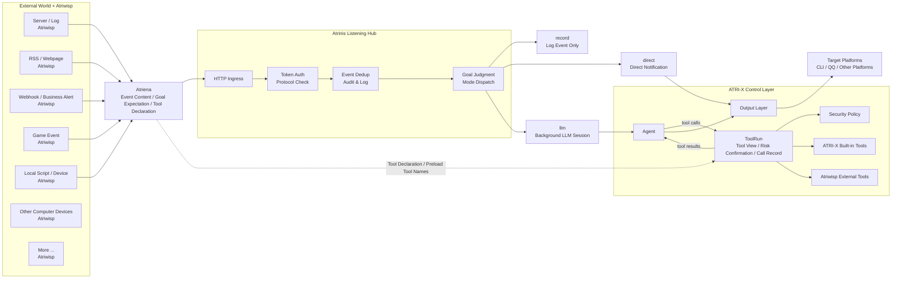

<!-- This file is auto-translated from docs/atrinis.md. Do not edit manually. -->

# Atrinis Listening Hub

Core Idea:

- Let ATRI-X control everything.
- Let Atrinis manage everything.
- Let Atriwisp observe everything.

Atrinis is the event listening hub of ATRI-X. Like a star, it catches signals from the constellation of Atriwisps, and ATRI-X then decides whether to record, notify, analyze, or execute background tasks.

## What problem does it solve

Ordinary chatbots usually only respond to user messages. Cron can respond to time, but it doesn't know what is happening in the outside world.

Atrinis allows ATRI-X to respond to the external world.

For example:

- When a server anomaly occurs, let the LLM analyze the logs and determine whether to send a notification.
- When an RSS feed updates, automatically summarize the content and push it to the target platform.
- When a game server generates an event, let ATRI-X record it, send a notification, or execute background tasks.
- When a Webhook receives a business alert, pass it to ATRI-X first to determine the severity.
- When a local script detects a state change, send the result to ATRI-X instead of sending messages haphazardly.

Simply put, Atrinis expands ATRI-X from a "bot that waits for users to speak" into an "Agent hub capable of perceiving the external world."

## Architecture Diagram



## Three Roles

### Atrinis

Atrinis is the event entry runtime within ATRI-X, assembled at the same level as the platform runtime and Cron runtime.

It uniformly receives external events and routes them to logs, notifications, or the background LLM; it is like a star around which all Atriwisp signals converge, but the ultimate energy is controlled by ATRI-X.

Atrinis is responsible for:

- Receiving Atriena event requests.
- Validating tokens and protocol fields.
- Deduplicate persistence based on `atriwisp.name + source + id`.
- Record Atrinis logs and audit information.
- Decide which platforms events can be delivered to.
- Execute `record`, `direct`, or `llm` according to the event mode.

Atrinis is not an ordinary chat platform, nor does it implement PlatformAdapter. External events cannot bypass the Agent, Tool Runtime, Security Policy, and Output Layer.

### Atriwisp

Atriwisp is an external sub-listener. It can be a shell script, a resident process, an RSS poller, a Webhook forwarder, a game server plugin, a log listener, a hardware status collector, or any program that can convert external signals into HTTP JSON.

The "world" it observes is not limited by type, including but not limited to:

- Operating system events.
- File and log changes.
- Server status.
- Game or business service events.
- RSS, web pages, Webhooks.
- Database or queue messages.
- Devices, sensors, or local script outputs.
- Any content that a computer can receive, read, listen to, or generate.

Atriwisp is the eyes of ATRI-X, acting like probes scattered across the external world. They can be numerous, small, and dispersed; they have only one responsibility: to tell Atrinis what is happening in the external world.

Atriwisp is only responsible for "seeing and reporting." It does not directly control ATRI-X, does not send messages directly to chat platforms, and does not decide whether to ultimately call an LLM or a tool.

### Atriena: event protocol

Atriena is the JSON over HTTP protocol used by Atriwisp to deliver events to Atrinis.

It is responsible for turning "what happened outside" into a unified event that Atrinis can understand: who the source is, what the event ID is, what the content is, how it should be handled, and where it should be delivered.


Initial endpoint:

```text
POST /atriena/v3/events
GET  /healthz
```

## How events are processed

After receiving an event, Atrinis determines the processing method according to `mode`.

| Mode | Function | Suitable Scenarios |
| --- | --- | --- |
| `record` | Only record events, without calling the LLM or sending notifications. | Event archiving, integration testing, low-priority signals. |
| `direct` | Directly send text notifications to the target determined by Atrinis. | Simple alerts, readable messages already generated by external systems. |
| `llm` | Enters a background LLM Session, where the model analyzes it to decide whether to report. | Events that require analysis, induction, judgment, or the use of tools. |

HTTP requests in `llm` mode will return quickly, and the actual processing is executed by a background worker. The LLM eventually needs to return a structured result:

```json
{
  "completed": true,
  "need_report": true,
  "report": "result"
}
```

During `need_report=true`, Atrinis will send `report` according to the adjudicated target.

## View Atriwisp logs

You can use `/atriwisp` to view Atrinis/Atriwisp event logs. It reads `atrinis-YYYY-MM-DD.log` and supports filtering by Atriwisp name, event source, event ID, mode, and time range.

Example:

```text
/atriwisp
/atriwisp server-watchdog -n 20
/atriwisp --source minecraft-main --mode llm --since 2h
```

## Relationship with Cron, Atriyph, and Skill

| Capability | Trigger Source | Function |
| --- | --- | --- |
| Cron | Time | Execute direct or LLM tasks when the time is reached. |
| Atrinis | external event | Receive events delivered by Atriwisp and distribute them for processing. |
| Atriyph | Task text | Describe tasks, steps, and constraints in a structured manner. |
| Skill | Reusable capabilities | Condense experience or code into discoverable and callable capabilities. |

Simply put: Cron is responsible for "when to do it", Atrinis is responsible for "what happened outside", Atriyph is responsible for "how the task is described", and Skill is responsible for "how capabilities are reused".

## Creating Atriwisp Auxiliary Tools

In work mode, the superadmin can let ATRI-X use the built-in tool `atriwisp_creator` to assist in creating Atriwisp. This tool returns creation guides, Atriena event templates, Atrinis configuration snippets, listener scaffolds, curl test commands, and security checklists; The actual writing of files or execution of commands is still handled by the file tool and shell tool.

For ready-made Atriwisp examples, protocol documentation, and templates, please refer to [Atriwisp Showcase](https://github.com/Elfreese/elwisp-showcase).

## Next Step: Configuration and Usage

- [Atrinis Configuration and Usage](atrinis-usage.md): Enable Atrinis, configure Atriwisp policies, send Atriena requests, and understand request fields and delivery boundaries.

